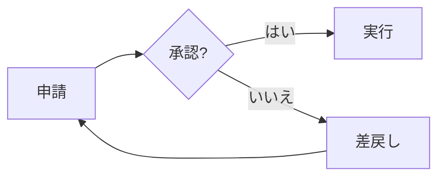

# mermaid-examples

Mermaid 入門セミナーの作例集です。Markdown、Issue、Pull Request で同じ記法を使い、図をコードとして共有・レビューする方法を体験できます。

## まず図を見る

- [全13例の描画ギャラリー](examples.md)
- [PR 演習で変更する申請フロー](approval-workflow.md)
- [Issue 一覧](https://github.com/RyusukeKimura/mermaid-examples/issues)：受付の追加を図で提案する実例
- [Pull Request 一覧](https://github.com/RyusukeKimura/mermaid-examples/pulls)：変更前後の図とコード差分を比較する実例

## GitHub で Mermaid を書く

Markdown ファイルや Issue・PR 本文に、言語名 `mermaid` のコードブロックを書きます。
以下を外側の4本のバッククォートを含めずにコピーしてください。

````markdown

````

GitHub のプレビューで図を確認できます。画像を別途アップロードする必要はありません。
`.mmd` は Mermaid 本体のソースです。図の閲覧には `examples.md` を、Mermaid Live Editor などへの貼り付けには `.mmd` の内容を使ってください。

## サンプル一覧

すべてリポジトリ直下に配置しています。ページ番号は参考資料の並び順です。

| ソース | 内容 | スライド |
| --- | --- | --- |
| [01-flowchart.mmd](01-flowchart.mmd) | 申請・承認フロー | 25 |
| [02-flowchart-reception.mmd](02-flowchart-reception.mmd) | 受付を追加したフロー | 4 |
| [03-subgraph.mmd](03-subgraph.mmd) | 画面とサーバー | 28 |
| [04-sequence.mmd](04-sequence.mmd) | 問い合わせの順序 | 29 |
| [05-sequence-alt.mmd](05-sequence-alt.mmd) | 正常系と例外処理 | 31 |
| [06-class.mmd](06-class.mmd) | 会員と予約のクラス図 | 32 |
| [07-state.mmd](07-state.mmd) | 予約の状態遷移 | 34 |
| [08-er.mmd](08-er.mmd) | 会員と予約のER図 | 35 |
| [09-gantt.mmd](09-gantt.mmd) | 制作スケジュール | 38 |
| [10-journey.mmd](10-journey.mmd) | 予約体験 | 40 |
| [11-gitgraph.mmd](11-gitgraph.mmd) | ブランチとマージ | 41 |
| [12-pie.mmd](12-pie.mmd) | 問い合わせの内訳 | 43 |
| [13-mindmap.mmd](13-mindmap.mmd) | 勉強会の準備 | 44 |

## Issue → PR の演習

1. Issue の「現在のフロー」と「提案するフロー」を見比べる。
2. PR の説明で変更前後を確認する。
3. PR の **Files changed** を開く。`A[申請] --> B{承認?}` が、受付を経由する2行に変わることを確認する。
4. `D --> A` は変わらず、差し戻し先が申請であることを確認する。
5. 必要ならレビューコメントで追加の変更を相談する。

実演用 PR は未マージです。`main` は受付追加前、PR のブランチは追加後になっています。完成形の作例は `02-flowchart-reception.mmd` とギャラリーでも閲覧できます。

本文を自分で試す場合は [issue-example.md](issue-example.md) と [pr-example.md](pr-example.md) の Raw 表示からコピーできます。

## 更新時のルール

- サンプルの `.mmd` を変更したら、`examples.md` の対応するブロックも更新する。
- 演習対象は `approval-workflow.mmd` と `approval-workflow.md` を一緒に更新する。
- 図は実装や業務の変更を自動取得しません。関連する変更と同じ PR でレビューすると、文書が古くなる Doc-Rot を減らせます。
- Gitグラフは説明用の定義であり、このリポジトリの実際のコミット履歴を取得するものではありません。

## 表示に問題がある場合

GitHub が利用する Mermaid のバージョンによって、対応構文や見た目が異なります。まず Preview を確認してください。次のブロックでバージョン情報を表示できます。

````markdown
```mermaid
info
```
````

## 参考資料

- [マーメイド記法入門（Google Slides）](https://docs.google.com/presentation/d/1_e2vrrhI-sdmFgYLuo8AOqMKZZ0HKCrOkhZQqalq2Ww/edit)：サンプルコードの出典。ガントチャートとユーザージャーニーはスピーカーノートを参照。
- [GitHub Docs: Creating diagrams](https://docs.github.com/en/get-started/writing-on-github/working-with-advanced-formatting/creating-diagrams)
- [Mermaid 公式ドキュメント](https://mermaid.js.org/)
- [Mermaid Live Editor](https://mermaid.live/)
