# Mermaid サンプル集

参考スライドのコードを収録しています。日程・数値は説明用の例です。

## 申請・承認フロー

ソース: [01-flowchart.mmd](01-flowchart.mmd) ／ 参考スライド 25 ページ

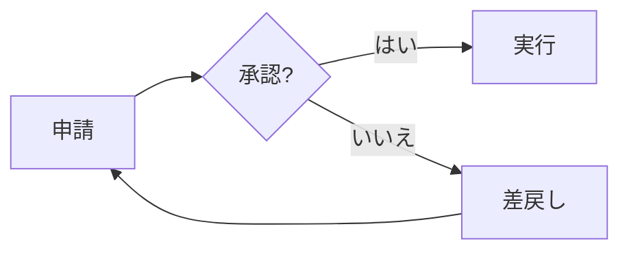

## 受付を追加したフロー

ソース: [02-flowchart-reception.mmd](02-flowchart-reception.mmd) ／ 参考スライド 4 ページ

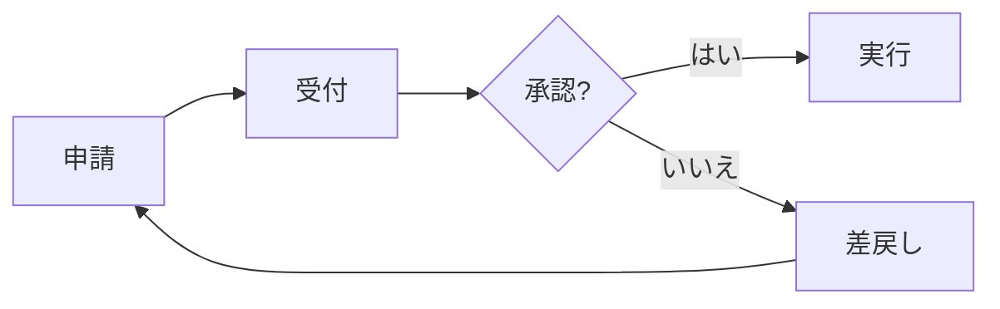

## 画面とサーバー

ソース: [03-subgraph.mmd](03-subgraph.mmd) ／ 参考スライド 28 ページ

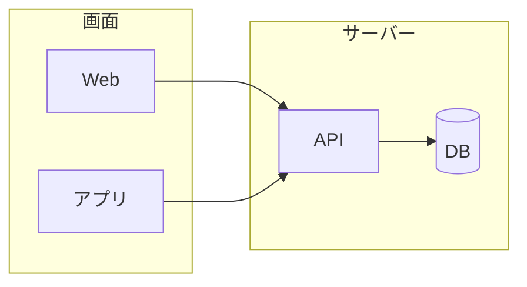

## 問い合わせの順序

ソース: [04-sequence.mmd](04-sequence.mmd) ／ 参考スライド 29 ページ

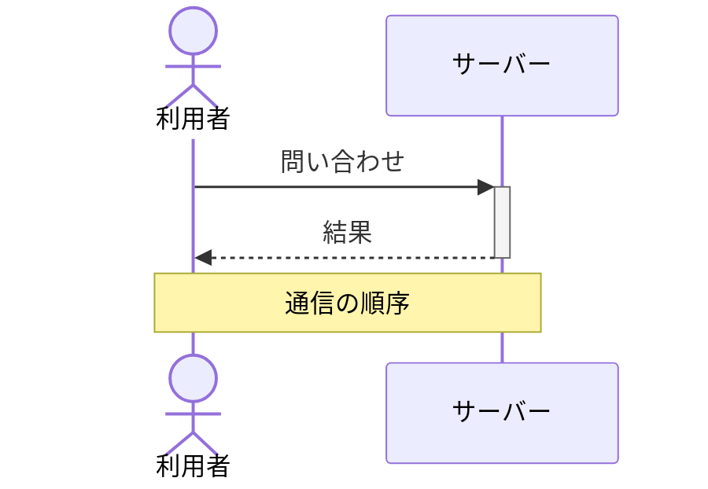

## 正常系と例外処理

ソース: [05-sequence-alt.mmd](05-sequence-alt.mmd) ／ 参考スライド 31 ページ

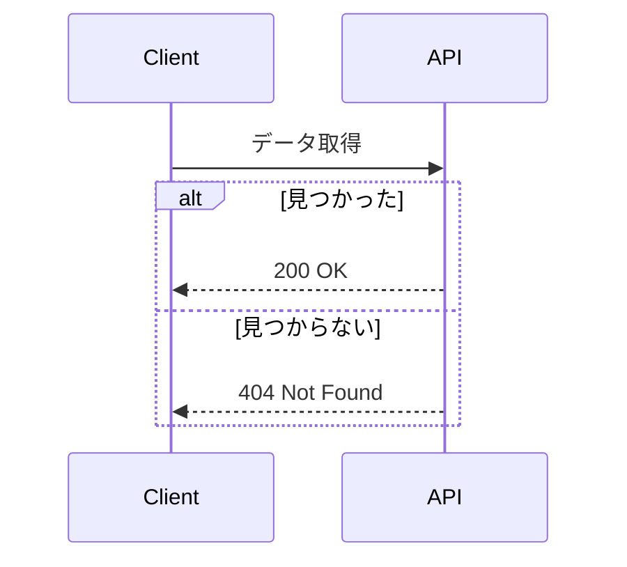

## 会員と予約のクラス図

ソース: [06-class.mmd](06-class.mmd) ／ 参考スライド 32 ページ

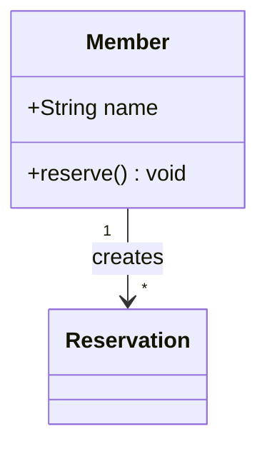

## 予約の状態遷移

ソース: [07-state.mmd](07-state.mmd) ／ 参考スライド 34 ページ

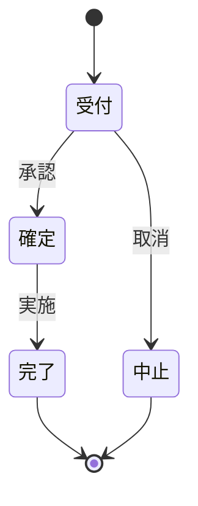

## 会員と予約のER図

ソース: [08-er.mmd](08-er.mmd) ／ 参考スライド 35 ページ

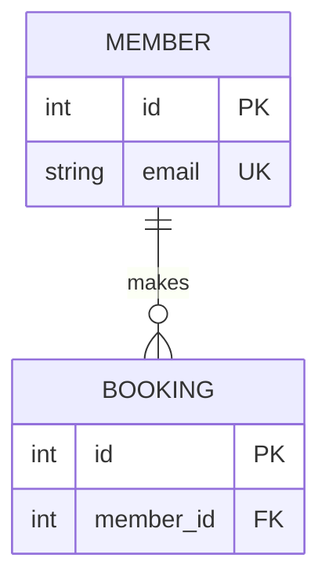

## 制作スケジュール

ソース: [09-gantt.mmd](09-gantt.mmd) ／ 参考スライド 38 ページ

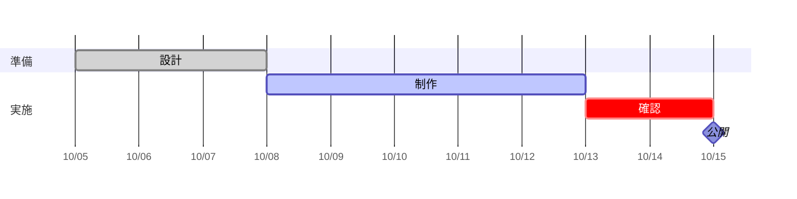

## 予約体験

ソース: [10-journey.mmd](10-journey.mmd) ／ 参考スライド 40 ページ

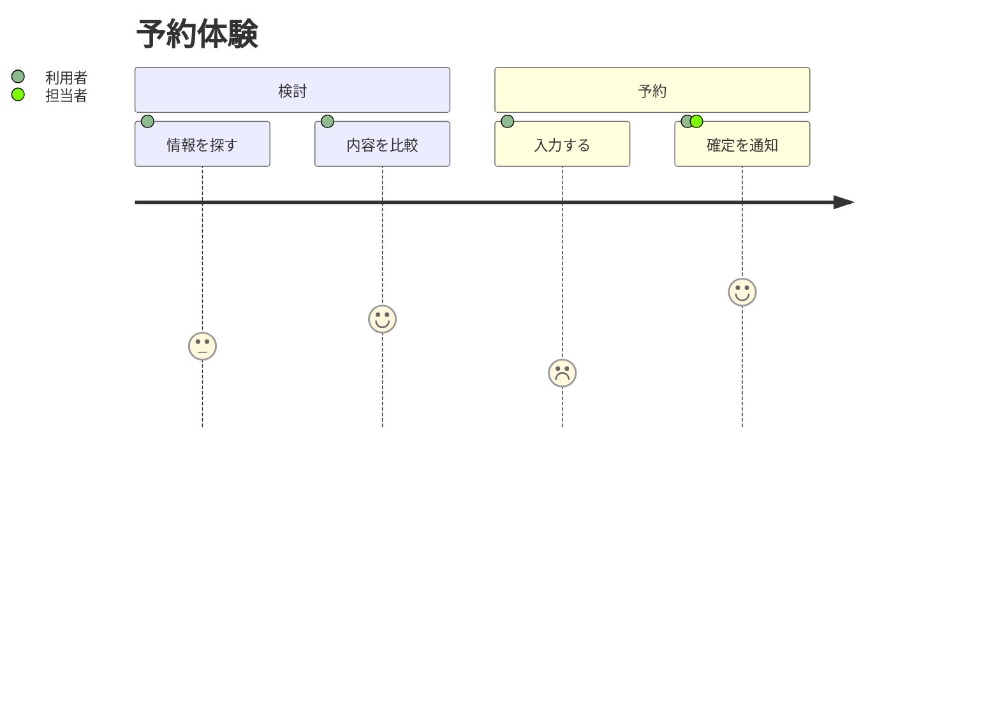

## ブランチとマージ

ソース: [11-gitgraph.mmd](11-gitgraph.mmd) ／ 参考スライド 41 ページ

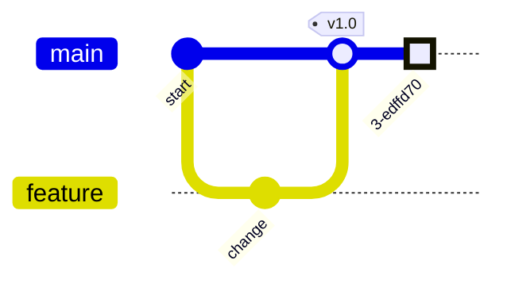

## 問い合わせの内訳

ソース: [12-pie.mmd](12-pie.mmd) ／ 参考スライド 43 ページ

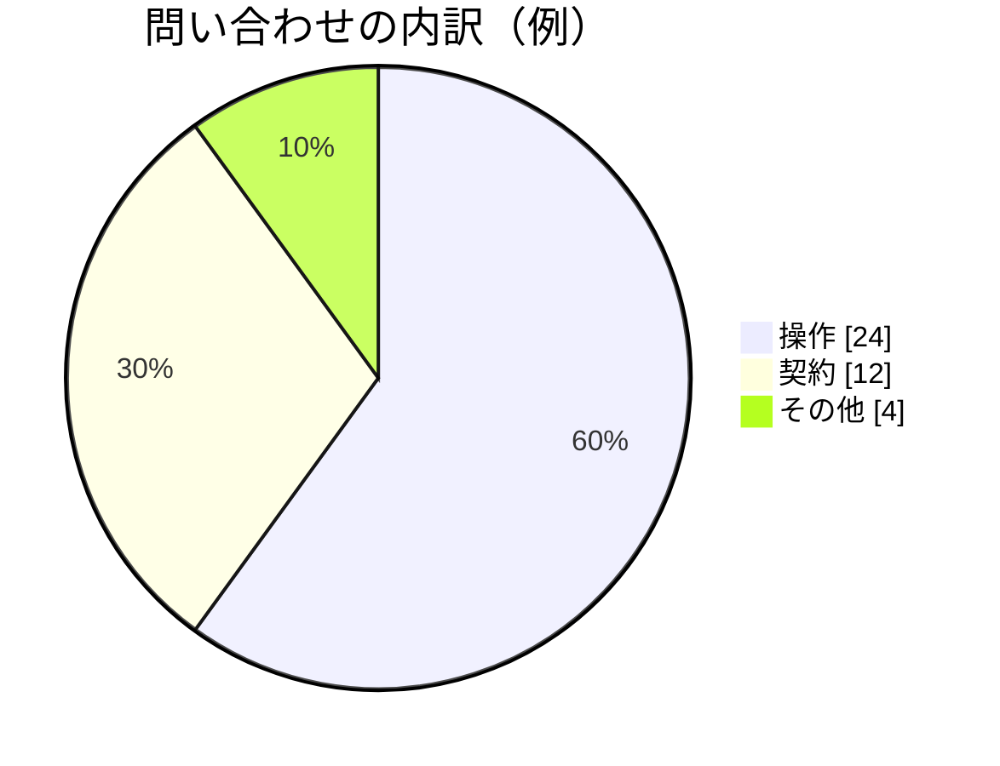

## 勉強会の準備

ソース: [13-mindmap.mmd](13-mindmap.mmd) ／ 参考スライド 44 ページ

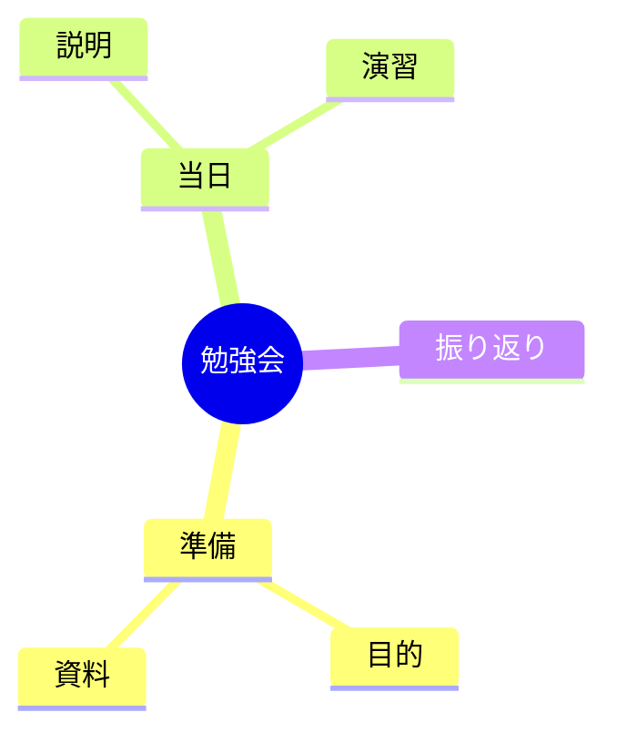
