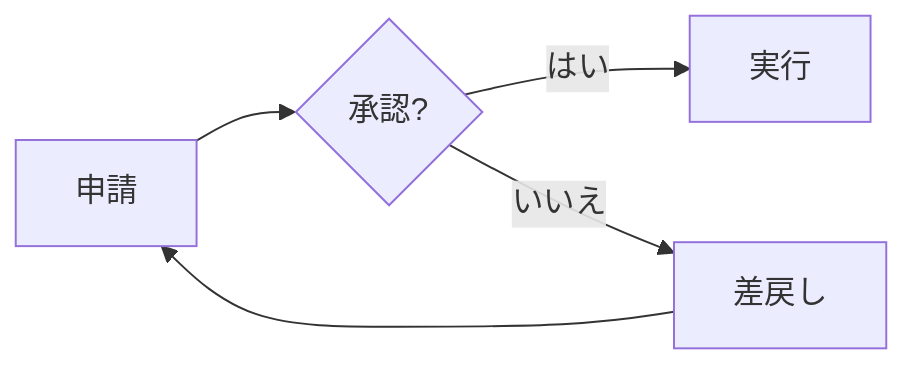
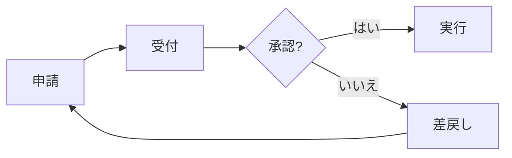

## 目的
申請と承認の間に「受付」を追加し、担当者が申請内容を確認する段階を明示します。
これはセミナー用のサンプル Issue です。

## 現在のフロー

## 提案するフロー

## 完了条件
- [ ] 申請 → 受付 → 承認の順にする
- [ ] 承認後の「実行」は維持する
- [ ] 差戻し → 申請の戻り先を維持する
- [ ] approval-workflow.mmd と approval-workflow.md を同じ PR で更新する

## 学習ポイント
Issue 本文の mermaid コードブロックで仕様を相談し、PR でコード差分と図を確認できます。
