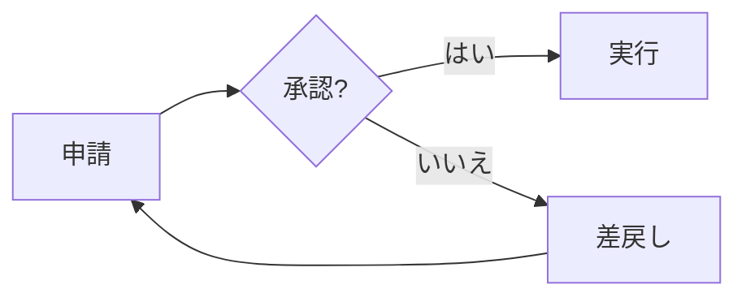
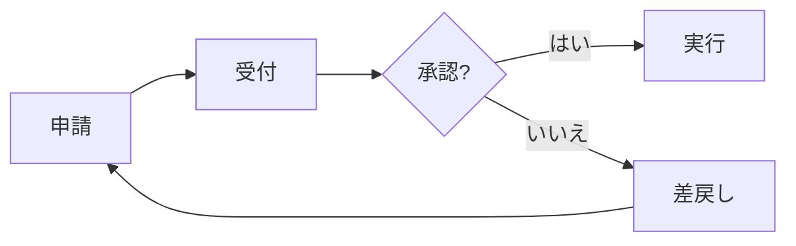

## 変更内容
申請と承認の間に受付を追加しました。差し戻し先は申請のままです。
approval-workflow.mmd と表示用の approval-workflow.md を一緒に更新します。

## 変更前

## 変更後

## レビューの観点
- 申請 → 受付 → 承認の順になっているか
- 「いいえ」の分岐が差戻しを経由して申請に戻るか
- Files changed で、図の変更がテキスト差分として読めるか

セミナー用の PR です。比較とレビューの実演に使えるよう未マージで残します。
